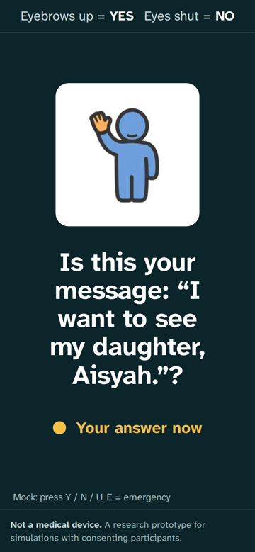
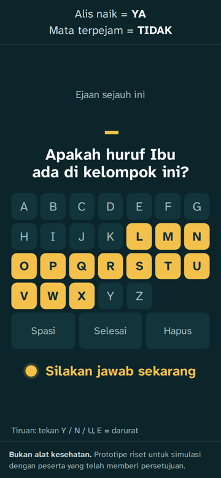
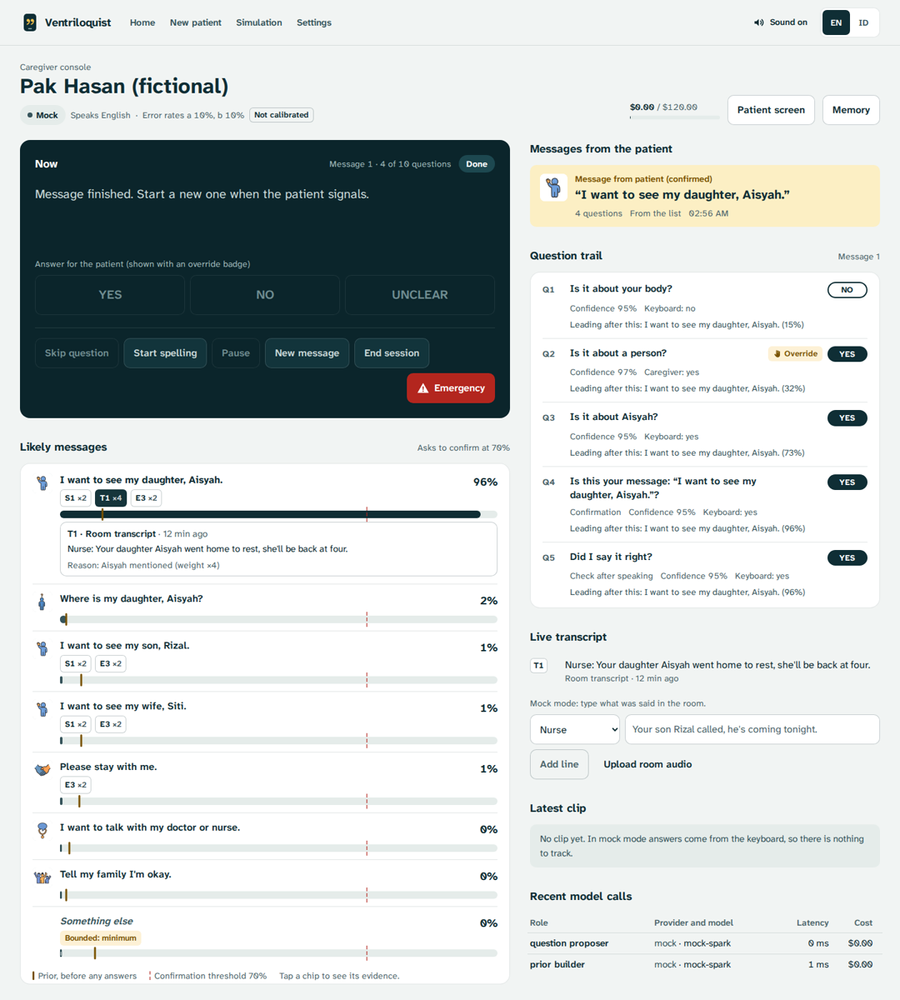
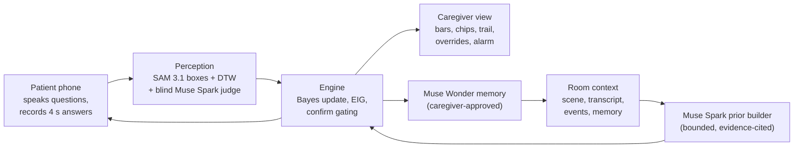
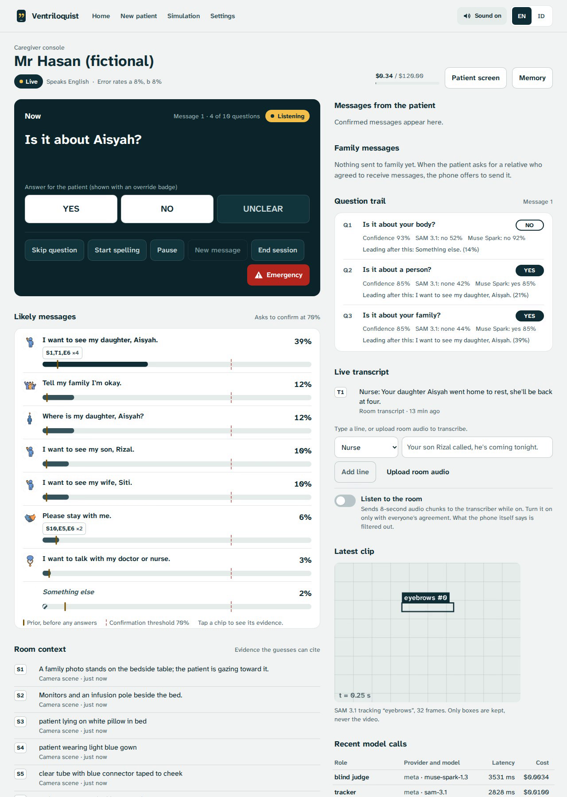
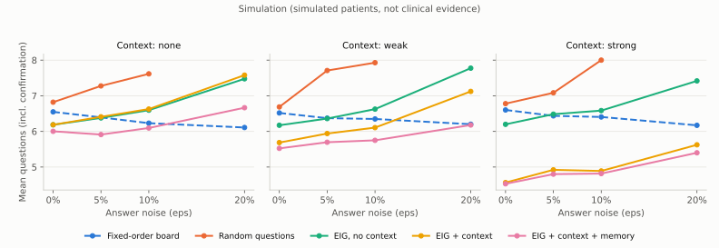
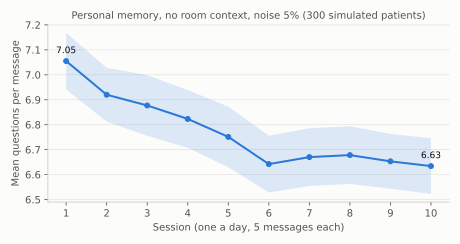
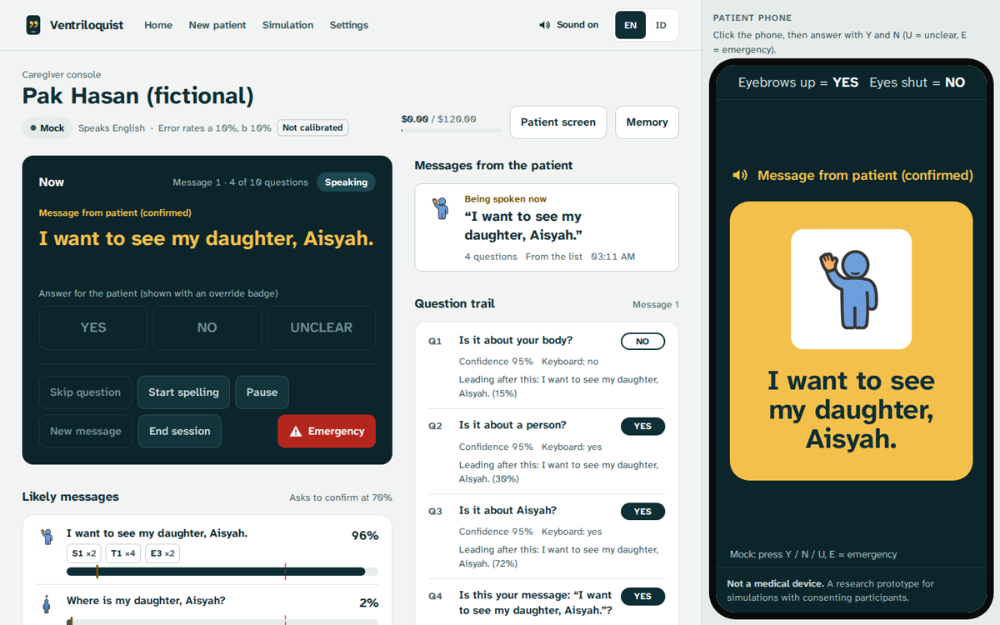

# Ventriloquist

[](https://github.com/0xNoramiya/ventriloquist/actions/workflows/ci.yml)
[](https://0xnoramiya.github.io/ventriloquist/)
[](LICENSE)

**The patient does the talking. The phone just moves its lips.**

A phone on the bed rail gives a voice to awake ICU patients who cannot speak because of a breathing
tube or tracheostomy. It asks the yes/no question that narrows things down fastest, reads whatever
movement the patient can make (raised eyebrows, a long blink, a finger lift), and only speaks a
message aloud, in the first person, after the patient has confirmed it.

**[Try the hosted demo](https://0xnoramiya.github.io/ventriloquist/)**: the real engine runs in your
browser, with no install, camera or keys.

> **Why the name.** "Vent" is ICU shorthand for a ventilator. In a bad version of this idea the
> machine is the ventriloquist: it guesses, and puts words in a silent patient's mouth. Ventriloquist
> flips that. The patient is the ventriloquist and the phone is only the voice. Blind perception,
> bounded guessing and confirm-before-speak exist to keep it that way.

**Not a medical device.** Not a substitute for the nurse call system, monitors or clinical judgment.
So far built and tested with fictional patients and synthetic media only; recordings with consenting
actors come next.

Solo entry by Rifqi, emergency medicine intern in Indonesia, for the Meta Global AI Developer
Hackathon 2026 (Indie Developer track, "Build for Your World").

---

## In 20 seconds

1. During a short calibration the patient shows their own YES and NO. Muse Spark watches the
   clips and names the movement; SAM 3.1 tracks that body part from then on.
2. When the patient wants to talk, Muse Spark reads the room (the nurse's words, the bedside photo,
   the visitor who just left) and proposes how much more or less likely each message is, citing
   evidence. Plain code bounds that influence.
3. The engine asks the question with the highest expected information gain under the patient's
   measured error rates, speaks it, and reads the answer from a 4-second clip. A blind judge that
   never sees the question checks the movement.
4. When one message reaches 70%, it asks "Is this your message?". Only a YES that lifts it to 95%
   lets the phone speak. Then: "Did I say it right?"
5. Anything not on the list gets spelled, with word completions. Three quick YES signals raise an
   alarm from any screen.

| Patient phone (confirm before speaking) | Patient phone (spelling, Indonesian) | Caregiver console |
|---|---|---|
|  |  |  |

Screenshots from mock mode with a fictional patient. The caregiver sees every probability, the
evidence behind each guess (chip T1: the nurse said Aisyah went home), the question trail with an
override badge on the one answer the caregiver entered, and the message the patient confirmed.

## The problem

A 2025 review of communication tools in intensive care reports that only about 5% of the messages
mechanically ventilated patients try to convey are correctly understood by healthcare providers, and
that about half of ventilated patients report communication difficulties [1].

Patients already try. In an observational study in an Iranian cardiac surgery ICU, most mechanically
ventilated patients communicated through purposeful stares, hand gestures and head nods [2]. Nurses
already ask yes/no questions when they have time.

Reading lips is hard even when the lips are free. In a Northern Ireland feasibility study of SRAVI, a
smartphone app that reads lip movements, with tracheostomy patients, the version limited to a set
phrase list was 21.8% accurate and the free-speech version 34.6%; the investigators concluded that a
larger trial is not currently feasible [3]. An earlier single-centre evaluation of SRAVI with 14
tracheostomy patients reported 75% top-1 accuracy on phrases from the app's supported phrase list [4].
Orally intubated patients have a tube in the mouth, which makes lip reading harder still.

So Ventriloquist does not read lips. It makes the yes/no conversation that already happens at the
bedside smarter, faster, and available whenever the patient wants to talk. Full citations and quotes:
[`docs/SOURCES.md`](docs/SOURCES.md).

## What it is, and what it is not

| It is | It is not |
|---|---|
| An AAC (augmentative and alternative communication) aid that helps the patient say what they want | A diagnostic or triage tool; it never interprets vital signs or answers medical questions |
| A transparent console for the caregiver: probabilities, evidence, every question and answer | A replacement for the nurse call system or for asking the patient in person |
| A voice for messages the patient confirmed | A lip reader, a sign-language reader or a voice clone |

The engine never proposes, ranks or asks about sensitive topics (refusing treatment, end of life,
self-harm, abuse, consent, legal or money decisions). The patient can still say anything by spelling;
a sensitive spelled message goes straight to the caregiver screen with "Verify in person with the
patient" and is not spoken until a caregiver acknowledges it.

## How it works



1. **Bring your own signal.** Calibration records rest, 3 YES and 3 NO clips. Muse Spark describes
   the movement and gives a SAM prompt such as "eyebrows"; SAM 3.1 tracks it on every clip to build
   templates; leave-one-out accuracy sets the fusion weights and the channel error rates.
2. **Context-aware priors with bounded influence.** Muse Spark sees evidence ids (S scene, T
   transcript, E caregiver event, M memory, H history) and proposes multipliers from {0.25, 0.5, 2, 4}
   for messages, each citing evidence, plus at most three new messages from fixed templates ("Where is
   my daughter, Aisyah?"). Code snaps, clips and bounds them: no message above 40% before the first
   answer, "something else" never below 8%.
3. **Expected information gain under a noisy channel.** For a yes-set with mass s and calibrated
   error rates a and b, EIG = H(P(observed YES)) - [s H(a) + (1 - s) H(b)]. The engine asks the best
   question minus a small penalty per word.
4. **Blind judging.** The perception models get the clip and the patient's signal description, never
   the question or the candidate messages, so they cannot answer for the patient. The judge watches
   a crop around the body parts the patient signals with, found by SAM 3.1 during calibration.
5. **Confirm before speaking, verify after.** Speaking needs a confirmation YES that lifts the message
   to 95%. Afterwards, "Did I say it right?"; NO retracts it on the caregiver screen.
6. **Memory that compounds.** Confirmed messages feed personal base rates (3-day half-life). After
   each session Muse Wonder reads the whole stay and proposes facts with provenance; a caregiver
   approves each one, and every entry can be deleted.

Details: [`docs/ARCHITECTURE.md`](docs/ARCHITECTURE.md). Client protocol: [`docs/PROTOCOL.md`](docs/PROTOCOL.md).

## Meta models and what each one does

| Model | Role in Ventriloquist |
|---|---|
| **Muse Spark 1.3** (Meta Model API) | Calibration describer (watches the YES/NO clips, names the movement, writes the SAM prompt); framing check; scene reader (bedside photo to facts, no identities); prior builder (evidence-cited multipliers and template messages); question proposer; blind answer judge on a crop around the patient's signal at 15 fps; spelling completer and sentence builder; sensitive-topic classifier; reader of relatives' WhatsApp replies (what the patient hears, and what a nurse must read first) |
| **SAM 3.1** (Meta Model API) | Tracks the patient's own signal (e.g. "eyebrows") across each answer clip; box geometry becomes features for DTW against the calibrated templates; boxes are drawn on the caregiver screen |
| **Muse Voice Transcribe** | Diarized room transcript with family names as keywords and an Indonesian language bias (without it, Indonesian came back empty in our probes) |
| **Muse Wonder** | Memory curator over the whole stay history (proposals with provenance, caregiver-approved) and memory selector before each session |
| **Muse Spark Open** (open weights, Baseten or Modal) | Privacy mode: the same Spark roles on an open-weight model, including room audio via its audio input |
| **Muse Glimmer** (open weights, on your own hardware) | Optional on-premises privacy tier: the text-only roles (priors, questions, completions, sentences, sensitive classifier, memory) on an OpenAI-compatible server in the hospital |
| **WhatsApp Cloud API** (Meta) | Family relay: carries the patient's confirmed words to a consenting relative as an approved template, and brings the reply back (simulated relative until an account is connected) |
| **Muse Image** | Generated the 34 AAC pictograms shown next to messages on the patient screen (`scripts/generate_pictograms.py`) |
| SAM 3.1 open weights (optional, self-hosted on Modal) | Privacy-mode tracker when an endpoint is configured; otherwise an on-device optical-flow tracker |

The photos on the landing and calibration pages are not from Meta models and play no part at
runtime. They show one fictional patient, generated through Higgsfield: GPT Image 2.5 for the
bedside, night and phone-mount photos, and stills from the Seedance 2.0 gesture clips described in
[`docs/DETECTOR_DATA_GENERATED.md`](docs/DETECTOR_DATA_GENERATED.md) for the YES/NO signal cards.

Every call is schema-validated (strict JSON schema on the Meta API), repaired once, then falls back
safely; every call is logged with model, latency, tokens and cost. Verified request and response
shapes: [`docs/API_NOTES.md`](docs/API_NOTES.md). A live run of every role: [`docs/LIVE_CHECK.md`](docs/LIVE_CHECK.md).



Live mode, three answers into a conversation with a fictional patient (synthetic answer clips). Each
answer in the trail shows what SAM 3.1 and the blind Muse Spark judge read; the bars cite the nurse's
remark (chip T1) that made Aisyah the leading guess; "Latest clip" shows the SAM box for the
eyebrows; and every model call is listed with its latency and cost.

## When nobody is in the room

A patient on a ventilator for muscle weakness often cannot press the call bell, and family is not
always there. So a spoken message does not end at the phone's speaker:

- **It reaches a person.** Every message appears on the caregiver screen with a chime until someone
  taps "I'm coming". Unacknowledged, the idle phone says it again every minute, twice, then the
  screen escalates. The patient's screen and voice confirm when it was seen.
- **It can reach family (agentic relay).** For a message about a relative ("Please call my son,
  Rizal", "I want to see my daughter, Aisyah"), the phone asks "Shall I send this to Aisyah on
  WhatsApp?". On YES and a caregiver's approval, an agent sends the patient's own words to that
  relative and tracks delivery and reading. When the reply comes, Muse Spark prepares it for the
  patient and holds anything about health, bad news or distress for a nurse. Otherwise the phone
  reads it aloud. With no reply, the agent tells the nurse and asks the patient whether to try the
  next relative.

The relay runs end to end with a simulated relative until a WhatsApp Business account is connected
(set-up and the template to register: [`docs/API_NOTES.md`](docs/API_NOTES.md#11c-whatsapp-cloud-api-family-relay)).

## Safety

Thirteen rules from the build brief plus two added since, each enforced in code and covered by
tests: no advice, no AI-proposed sensitive messages, confirm gating, post-speak check, emergency
from any state, blind judging, bounded priors, fatigue caps, human override everywhere,
transparency, privacy, memory hygiene, every spoken message reaching a person, and family relay
only with consent. The table with file and test names is in [`docs/SAFETY.md`](docs/SAFETY.md).

## Evaluation

### Engine simulation

`make sim` runs 2,000 seeded trials per cell with simulated patients (answers flipped at rate eps)
and compares five strategies under identical conditions. **Simulation, not clinical evidence.**



At 10% answer noise with strong context, EIG with context finalized in **4.89** questions on average
(including the confirmation) against **6.41** for a fixed-order board, with 67.2% vs 54.8% of
messages correct within the 10-question cap, and fewer wrong messages finalized (0.5% vs 2.6%).
Under heavy noise the engine hands over to the caregiver instead of guessing. Every table:
[`docs/EVAL.md`](docs/EVAL.md).

Memory compounds, modestly: with personal base rates learned from confirmed messages (no room
context), simulated patients needed 7.05 questions per message on day 1 and 6.63 by day 10.



### Detector

Real-patient detector numbers need labelled clips from consenting participants
(`scripts/eval_detector.py`, data in `data/labeled/`, never committed); they are not recorded yet.
On synthetic cartoon clips (`docs/DETECTOR_EVAL_SYNTHETIC.md`) the pipeline runs end to end. In the
live check (`docs/LIVE_CHECK.md`), Muse Spark named the eyebrow raise and chose "eyebrows" as the SAM
prompt, and SAM-based calibration reached 0.86 leave-one-out accuracy. Across runs the answer windows
(YES, NO, rest) were classified correctly or, once, returned UNCLEAR because the blind judge
disagreed with SAM; UNCLEAR means the question is asked again, which is the intended behaviour. The
detector's softmin temperature is fitted on the calibration clips (temperature scaling on the
leave-one-out likelihood); before that fix every window came back UNCLEAR.

On the live models, 12 synthetic windows (YES, NO, no answer, and the emergency signal of three quick
eyebrow raises) were all classified correctly, by SAM alone and fused
([`docs/DETECTOR_EVAL_SYNTHETIC.md`](docs/DETECTOR_EVAL_SYNTHETIC.md)). The wait after the 4-second
window was 3.4 s median, 3.6 s p90, against 4.0 s and 4.4 s when everything ran at 15 fps. SAM 3.1
gets an 8 fps copy of each clip, which is faster at equal accuracy. Muse Spark keeps 15 fps: on
8 fps clips the judge counted two eyebrow raises as four and called an emergency on 7 of 9
two-raise clips; at 15 fps it was right 21 times out of 21. SAM decides alone only on a clear YES
or NO: at least 90% sure and its best template at least 1.25 times closer than the next. The
judge's verdict is then attached to the trail when it arrives, with an alert if it disagrees and the
alarm if it saw the emergency signal. "No answer" always waits for the judge, because a live run
showed SAM confidently missing a movement the judge saw. These numbers say nothing about real
patients.

**A photoreal face.** The cartoon was too easy, so we generated a fictional ICU patient with
Higgsfield (GPT Image 2.5, then Seedance 2.0 for each gesture) and checked every label frame by
frame. On it the first run got only 5 of 13 windows right: on a whole 320x240 frame, Muse Spark
missed eyebrow raises a few pixels tall and took blinks for the NO squeeze. Four fixes followed:
- the judge now watches a crop around the signal body parts that SAM found during calibration;
- prompt v4 tells a blink from a held squeeze;
- SAM reports whether the body part was seen at all;
- fusion became a logarithmic opinion pool.

Now 11 of 13 are right, none wrong, and 2 come back as "ask again"; the judge alone was right on all
12 it answered. Details: [`docs/DETECTOR_DATA_GENERATED.md`](docs/DETECTOR_DATA_GENERATED.md).


## Privacy mode

Toggle it per session or in settings. The same pipeline runs on open-weight models:

- **Partner inference:** Muse Spark Open on Baseten (whose synchronous Model APIs fall under its
  zero-data-retention policy) or on Modal, so patient video need not touch a closed API.
- **On-premises:** Muse Glimmer on a GPU box in the hospital (any OpenAI-compatible server) takes
  every text-only role. Images and video then stay on-device, read by the local optical-flow tracker,
  so nothing leaves the building. In Indonesia, where health data is specific personal data under
  UU 27/2022, that matters.

SAM runs on a self-hosted endpoint if one is configured, otherwise on the on-device tracker. With no
open-weight endpoint configured, privacy mode stays fully on-device with mock models. In live mode
every Meta request is sent with `store: false`.

**Tested on Baseten.** On the generated clips, privacy mode gets 11 of 13 answer windows right: every
YES, NO and emergency signal, with two resting clips misread as NO (live mode: 11 right, none
wrong). A median answer takes 7.5 s, against 3.8 s live. Getting there took three changes that only
a live key could show:
- Muse Spark Open takes at most 2 videos per request, so calibration sends it one YES and one NO clip;
- without SAM, the judge's crop comes from where the calibration clips move, computed on the device;
- Baseten samples video at 2 frames per second with no setting for it, which blurred three eyebrow
  raises into one, so the adapter plays clips at half speed and tells the model.

Details: [`docs/DETECTOR_DATA_GENERATED.md`](docs/DETECTOR_DATA_GENERATED.md#privacy-mode-on-muse-spark-open-baseten).

## Hosted demo (no install)



The demo page runs the real engine, written in Python, inside the browser through WebAssembly
(Pyodide): the same session code, safety checks and mock models as the server, with the caregiver
console and a phone-sized patient view side by side. No server, no camera, no keys. Answer with Y
and N, or tick "Simulated patient" and watch.

Open it at **https://0xnoramiya.github.io/ventriloquist/**. It deploys to GitHub Pages from `.github/workflows/pages.yml` on every
push to `main`. Locally: `cd frontend && npm run dev:demo`.

## Deployed app

**https://ventriloquist.fly.dev** runs the full app: the caregiver console, the patient phone with
its camera, and the family relay. Visitors get mock mode, which costs nothing. A browser that enters
the passcode in Settings gets live mode with Meta's models; ask the author for it. Sessions live in
memory on one machine that suspends when idle; the database and calibrations sit on a volume. Deploy
with `make deploy` (`fly.toml`, `Dockerfile`; secrets `MODEL_API_KEY` and `LIVE_PASSCODE`).

## Quickstart

Requirements: Python 3.11+, [uv](https://docs.astral.sh/uv/), Node 20+, ffmpeg.

```bash
git clone https://github.com/0xNoramiya/ventriloquist.git && cd ventriloquist
make setup          # backend venv + frontend packages, creates .env from .env.example
make test           # backend tests + frontend checks
make demo-mock      # a full simulated session in the terminal, no keys needed
make dev            # backend :8000, laptop http://localhost:5174, phone https://<laptop-ip>:5173
```

**Mock mode** (default, no keys): open `http://localhost:5174` and start the "daughter" scenario.
Open the patient view on the laptop, or on a phone on the same network
(`https://<laptop-ip>:5173/patient/<id>`; accept the self-signed certificate, since phones need
HTTPS for the camera). Answer with Y / N / U / E on a keyboard, or let the simulated patient answer.

**Mock mode with a camera**: calibrate the patient (`/setup`, then `/calibrate`). Once a patient has a
real calibration, the patient view reads answers from the camera even without keys, using the
on-device optical-flow tracker; nothing leaves the machine.

**Live mode**: set `MODEL_API_KEY` in `.env` and a `LIVE_PASSCODE`, then switch to live in Settings
(or set `APP_MODE=live` in `.env`; a mode saved from Settings takes precedence over `.env`).
`make probe` checks every endpoint; `PYTHONPATH=backend:. backend/.venv/bin/python scripts/live_check.py`
runs every role for well under a dollar. The budget guard warns at 70% of `budget.max_usd` and switches
to mock at 90%.

**Privacy mode**: set `BASETEN_API_KEY` (or `MODAL_SPARK_URL`) and/or `LOCAL_LLM_URL` (Muse Glimmer on
your own server; optionally `MODAL_SAM_URL`), then enable privacy in Settings.

## Repository layout

```
backend/app/engine      decision engine: priors, information gain, Bayes update, spelling, personal learning
backend/app/perception  answer detection: SAM 3.1 + DTW, blind judge, fusion, on-device tracker
backend/app/providers   Meta Model API, Baseten/Modal, on-premises and mock adapters
backend/app/sessions    session orchestrator and state machine
backend/app/safety      sensitive-topic and no-advice guards
backend/app/prompts     versioned prompts for every model role
frontend/               React app: caregiver console, patient phone view, hosted demo
sim/                    simulations behind the evaluation charts
scripts/                API probes, live check, detector evaluation, asset builders
docs/                   architecture, protocol, safety, evaluation, API notes, sources
```

## Built during the hackathon

Kickoff 2026-10-26 16:00 UTC; everything in this repository was written after that, in dated commits.
The dated build log is [`HACKATHON_LOG.md`](HACKATHON_LOG.md) and the task list is [`TASKS.md`](TASKS.md).

## Limitations and next steps

- Needs clinical validation and ethics approval before any use with patients. Not a medical device.
- The detector is untested on real patients. Sedation, delirium, weakness, tape over the face, poor
  light and camera placement will all cost accuracy; the next step is recording labelled clips with
  consenting volunteers and tuning thresholds.
- Indonesian strings and the sensitive-topic lists need native and clinical review
  ([`docs/I18N_REVIEW.md`](docs/I18N_REVIEW.md)). Indonesian transcription needs testing on real speech.
- In live mode one question takes about 10 to 11 s end to end: 2.5 to 3.5 s to speak the question,
  the 4 s answer window, about 3 s for the models. The window is a setting; shortening it needs
  testing with real patients.
- Base rates are starting guesses. Personal learning helps, but only after a few confirmed messages.
- Zero data retention on the Meta API is an organisation-level setting that has to be requested.

## License and acknowledgments

MIT ([`LICENSE`](LICENSE)). Letter statistics come from public-domain texts (Project Gutenberg) and
Indonesian statutes, which carry no copyright (UU 28/2014 Art. 42); see `docs/SOURCES.md`. Models by
Meta (Muse Spark, SAM 3.1, Muse Voice Transcribe, Muse Wonder, Muse Image, Muse Spark Open, Muse Glimmer). SAM 3.1 weights are
under the SAM License and are never committed here.

### References

1. Çelebi C, Öztepe Yeşilyurt K. Ensuring effective communication with patients receiving mechanical ventilation support in intensive care units: current communication materials. Cyprus J Med Sci. 2025;10(4):228-235. https://doi.org/10.4274/cjms.2025.2025-28
2. Momennasab M, Shaker Ardakani M, Dehghan Rad F, Dokoohaki R, Dakhesh R, Jaberi A. Quality of nurses' communication with mechanically ventilated patients in a cardiac surgery intensive care unit. Invest Educ Enferm. 2019;37(2):e02. https://doi.org/10.17533/udea.iee.v37n2e02
3. NHS Health Research Authority. Speech Recognition Application for the Voice Impaired (SRAVI) V1.0, research summary (IRAS 307199). https://www.hra.nhs.uk/planning-and-improving-research/application-summaries/research-summaries/speech-recognition-application-for-the-voice-impaired-sravi-v10/
4. Musalia M, Laha S, Cazalilla-Chica J, et al. A user evaluation of speech/phrase recognition software in critically ill patients: a DECIDE-AI feasibility study. Crit Care. 2023;27:277. https://doi.org/10.1186/s13054-023-04420-x
