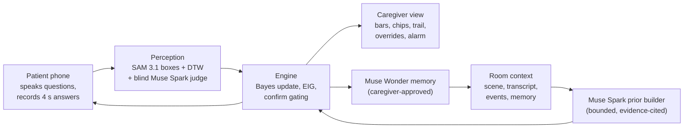

# Ventriloquist

**The patient does the talking. The phone just moves its lips.**

A phone on the bed rail gives a voice to awake ICU patients who cannot speak because of a breathing
tube or tracheostomy. It asks the yes/no question that narrows things down fastest, reads whatever
movement the patient can make (raised eyebrows, a long blink, a finger lift), and only speaks a
message aloud, in the first person, after the patient has confirmed it.

> **Why the name.** "Vent" is ICU shorthand for a ventilator. In a bad version of this idea the
> machine is the ventriloquist: it guesses, and puts words in a silent patient's mouth. Ventriloquist
> flips that. The patient is the ventriloquist and the phone is only the voice. Blind perception,
> bounded guessing and confirm-before-speak exist to keep it that way.

**Not a medical device.** Not a substitute for the nurse call system, monitors or clinical judgment.
So far built and tested with fictional patients and synthetic media only; recordings with consenting
actors come next.

Solo entry by Rifqi, emergency medicine intern in Indonesia, for the Meta Global AI Developer
Hackathon 2026 (Indie Developer track, "Build for Your World").

---

## In 20 seconds

1. During a short calibration the patient shows their own YES and NO. Muse Spark watches the
   clips and names the movement; SAM 3.1 tracks that body part from then on.
2. When the patient wants to talk, Muse Spark reads the room (the nurse's words, the bedside photo,
   the visitor who just left) and proposes how much more or less likely each message is, citing
   evidence. Plain code bounds that influence.
3. The engine asks the question with the highest expected information gain under the patient's
   measured error rates, speaks it, and reads the answer from a 4-second clip. A blind judge that
   never sees the question checks the movement.
4. When one message reaches 70%, it asks "Is this your message?". Only a YES that lifts it to 95%
   lets the phone speak. Then: "Did I say it right?"
5. Anything not on the list gets spelled, with word completions. Three quick YES signals raise an
   alarm from any screen.

| Patient phone (confirm before speaking) | Patient phone (spelling, Indonesian) | Caregiver console |
|---|---|---|
|  |  |  |

Screenshots from mock mode with a fictional patient. The caregiver sees every probability, the
evidence behind each guess (chip T1: the nurse said Aisyah went home), the question trail with an
override badge on the one answer the caregiver entered, and the message the patient confirmed.

## The problem

A 2025 review of communication tools in intensive care reports that only about 5% of the messages
mechanically ventilated patients try to convey are correctly understood by healthcare providers, and
that about half of ventilated patients report communication difficulties [1].

Patients already try. In an observational study in an Iranian cardiac surgery ICU, most mechanically
ventilated patients communicated through purposeful stares, hand gestures and head nods [2]. Nurses
already ask yes/no questions when they have time.

Reading lips is hard even when the lips are free. In a Northern Ireland feasibility study of SRAVI, a
smartphone app that reads lip movements, with tracheostomy patients, the version limited to a set
phrase list was 21.8% accurate and the free-speech version 34.6%; the investigators concluded that a
larger trial is not currently feasible [3]. An earlier single-centre evaluation of SRAVI with 14
tracheostomy patients reported 75% top-1 accuracy on phrases from the app's supported phrase list [4].
Orally intubated patients have a tube in the mouth, which makes lip reading harder still.

So Ventriloquist does not read lips. It makes the yes/no conversation that already happens at the
bedside smarter, faster, and available whenever the patient wants to talk. Full citations and quotes:
[`docs/SOURCES.md`](docs/SOURCES.md).

## What it is, and what it is not

| It is | It is not |
|---|---|
| An AAC (augmentative and alternative communication) aid that helps the patient say what they want | A diagnostic or triage tool; it never interprets vital signs or answers medical questions |
| A transparent console for the caregiver: probabilities, evidence, every question and answer | A replacement for the nurse call system or for asking the patient in person |
| A voice for messages the patient confirmed | A lip reader, a sign-language reader or a voice clone |

The engine never proposes, ranks or asks about sensitive topics (refusing treatment, end of life,
self-harm, abuse, consent, legal or money decisions). The patient can still say anything by spelling;
a sensitive spelled message goes straight to the caregiver screen with "Verify in person with the
patient" and is not spoken until a caregiver acknowledges it.

## How it works



1. **Bring your own signal.** Calibration records rest, 3 YES and 3 NO clips. Muse Spark describes
   the movement and gives a SAM prompt such as "eyebrows"; SAM 3.1 tracks it on every clip to build
   templates; leave-one-out accuracy sets the fusion weights and the channel error rates.
2. **Context-aware priors with bounded influence.** Muse Spark sees evidence ids (S scene, T
   transcript, E caregiver event, M memory, H history) and proposes multipliers from {0.25, 0.5, 2, 4}
   for messages, each citing evidence, plus at most three new messages from fixed templates ("Where is
   my daughter, Aisyah?"). Code snaps, clips and bounds them: no message above 40% before the first
   answer, "something else" never below 8%.
3. **Expected information gain under a noisy channel.** For a yes-set with mass s and calibrated
   error rates a and b, EIG = H(P(observed YES)) - [s H(a) + (1 - s) H(b)]. The engine asks the best
   question minus a small penalty per word.
4. **Blind judging.** The perception models get the clip and the patient's signal description, never
   the question or the candidate messages, so they cannot answer for the patient.
5. **Confirm before speaking, verify after.** Speaking needs a confirmation YES that lifts the message
   to 95%. Afterwards, "Did I say it right?"; NO retracts it on the caregiver screen.
6. **Memory that compounds.** Confirmed messages feed personal base rates (3-day half-life). After
   each session Muse Wonder reads the whole stay and proposes facts with provenance; a caregiver
   approves each one, and every entry can be deleted.

Details: [`docs/ARCHITECTURE.md`](docs/ARCHITECTURE.md). Client protocol: [`docs/PROTOCOL.md`](docs/PROTOCOL.md).

## Meta models and what each one does

| Model | Role in Ventriloquist |
|---|---|
| **Muse Spark 1.3** (Meta Model API) | Calibration describer (watches the YES/NO clips, names the movement, writes the SAM prompt); framing check; scene reader (bedside photo to facts, no identities); prior builder (evidence-cited multipliers and template messages); question proposer; blind answer judge on 4 s video at 8 fps; spelling completer and sentence builder; sensitive-topic classifier |
| **SAM 3.1** (Meta Model API) | Tracks the patient's own signal (e.g. "eyebrows") across each answer clip; box geometry becomes features for DTW against the calibrated templates; boxes are drawn on the caregiver screen |
| **Muse Voice Transcribe** | Diarized room transcript with family names as keywords and an Indonesian language bias (without it, Indonesian came back empty in our probes) |
| **Muse Wonder** | Memory curator over the whole stay history (proposals with provenance, caregiver-approved) and memory selector before each session |
| **Muse Spark Open** (open weights, Baseten or Modal) | Privacy mode: the same Spark roles on an open-weight model, including room audio via its audio input |
| **Muse Glimmer** (open weights, on your own hardware) | Optional on-premises privacy tier: the text-only roles (priors, questions, completions, sentences, sensitive classifier, memory) on an OpenAI-compatible server in the hospital |
| **Muse Image** | Generated the 34 AAC pictograms shown next to messages on the patient screen (`scripts/generate_pictograms.py`) |
| SAM 3.1 open weights (optional, self-hosted on Modal) | Privacy-mode tracker when an endpoint is configured; otherwise an on-device optical-flow tracker |

Every call is schema-validated (strict JSON schema on the Meta API), repaired once, then falls back
safely; every call is logged with model, latency, tokens and cost. Verified request and response
shapes: [`docs/API_NOTES.md`](docs/API_NOTES.md). A live run of every role: [`docs/LIVE_CHECK.md`](docs/LIVE_CHECK.md).

## Safety

Thirteen rules from the build brief, each enforced in code and covered by tests: no advice, no
AI-proposed sensitive messages, confirm gating, post-speak check, emergency from any state, blind
judging, bounded priors, fatigue caps, human override everywhere, transparency, privacy, and memory
hygiene. The table with file and test names is in [`docs/SAFETY.md`](docs/SAFETY.md).

## Evaluation

### Engine simulation

`make sim` runs 2,000 seeded trials per cell with simulated patients (answers flipped at rate eps)
and compares five strategies under identical conditions. **Simulation, not clinical evidence.**


At 10% answer noise with strong context, EIG with context finalized in **4.89** questions on average
(including the confirmation) against **6.41** for a fixed-order board, with 67.2% vs 54.8% of
messages correct within the 10-question cap, and fewer wrong messages finalized (0.5% vs 2.6%).
Under heavy noise the engine hands over to the caregiver instead of guessing. Every table:
[`docs/EVAL.md`](docs/EVAL.md).

Memory compounds, modestly: with personal base rates learned from confirmed messages (no room
context), simulated patients needed 7.05 questions per message on day 1 and 6.63 by day 10.


### Detector

Real-patient detector numbers need labelled clips from consenting participants
(`scripts/eval_detector.py`, data in `data/labeled/`, never committed); they are not recorded yet.
On synthetic cartoon clips (`docs/DETECTOR_EVAL_SYNTHETIC.md`) the pipeline runs end to end. In the
live check (`docs/LIVE_CHECK.md`), Muse Spark named the eyebrow raise and chose "eyebrows" as the SAM
prompt, and SAM-based calibration reached 0.86 leave-one-out accuracy. Across runs the answer windows
(YES, NO, rest) were classified correctly or, once, returned UNCLEAR because the blind judge
disagreed with SAM; UNCLEAR means the question is asked again, which is the intended behaviour. The
detector's softmin temperature is fitted on the calibration clips (temperature scaling on the
leave-one-out likelihood); before that fix every window came back UNCLEAR. Latency after the
4-second window is about 4 to 5 s (SAM 3.1 about 3 s at 320x240, the judge about 4 s); when SAM is
at least 90% sure the engine moves on without waiting for the judge, whose verdict is attached to
the trail afterwards and raises an alert if it disagrees. These numbers say nothing about real patients.

## Privacy mode

Toggle it per session or in settings. The same pipeline runs on open-weight models:

- **Partner inference:** Muse Spark Open on Baseten (whose synchronous Model APIs fall under its
  zero-data-retention policy) or on Modal, so patient video need not touch a closed API.
- **On-premises:** Muse Glimmer on a GPU box in the hospital (any OpenAI-compatible server) takes
  every text-only role. Images and video then stay on-device, read by the local optical-flow tracker,
  so nothing leaves the building. In Indonesia, where health data is specific personal data under
  UU 27/2022, that matters.

SAM runs on a self-hosted endpoint if one is configured, otherwise on the on-device tracker. With no
open-weight endpoint configured, privacy mode stays fully on-device with mock models. In live mode
every Meta request is sent with `store: false`.

## Hosted demo (no install)


The demo page runs the real engine, written in Python, inside the browser through WebAssembly
(Pyodide): the same session code, safety checks and mock models as the server, with the caregiver
console and a phone-sized patient view side by side. No server, no camera, no keys. Answer with Y
and N, or tick "Simulated patient" and watch.

It deploys to GitHub Pages from `.github/workflows/pages.yml` (Settings > Pages > Source: GitHub
Actions), at `https://<user>.github.io/<repo>/`. Locally: `cd frontend && npm run dev:demo`.

## Quickstart

Requirements: Python 3.11+, [uv](https://docs.astral.sh/uv/), Node 20+, ffmpeg.

```bash
git clone <repo> ventriloquist && cd ventriloquist
make setup          # backend venv + frontend packages, creates .env from .env.example
make test           # backend tests + frontend checks
make demo-mock      # a full simulated session in the terminal, no keys needed
make dev            # backend :8000, laptop http://localhost:5174, phone https://<laptop-ip>:5173
```

**Mock mode** (default, no keys): open `http://localhost:5174`, start the "daughter" scenario,
open the patient view on a phone on the same network (`https://<laptop-ip>:5173/patient/<id>`, accept
the self-signed certificate; phones need HTTPS for the camera, the laptop's own localhost does not) and answer with Y / N / U / E on a keyboard, or let the simulated patient
answer.

**Mock mode with a camera**: calibrate the patient (`/setup`, then `/calibrate`). Once a patient has a
real calibration, the patient view reads answers from the camera even without keys, using the
on-device optical-flow tracker; nothing leaves the machine.

**Live mode**: set `MODEL_API_KEY` in `.env` and a `LIVE_PASSCODE`, then switch to live in Settings
(or set `APP_MODE=live` in `.env`; a mode saved from Settings takes precedence over `.env`).
`make probe` checks every endpoint; `PYTHONPATH=backend:. backend/.venv/bin/python scripts/live_check.py`
runs every role for well under a dollar. The budget guard warns at 70% of `budget.max_usd` and switches
to mock at 90%.

**Privacy mode**: set `BASETEN_API_KEY` (or `MODAL_SPARK_URL`) and/or `LOCAL_LLM_URL` (Muse Glimmer on
your own server; optionally `MODAL_SAM_URL`), then enable privacy in Settings.

## Built during the hackathon

Kickoff 2026-10-26 16:00 UTC; everything in this repository was written after that, in dated commits.
The dated build log is [`HACKATHON_LOG.md`](HACKATHON_LOG.md) and the task list is [`TASKS.md`](TASKS.md).

## Limitations and next steps

- Needs clinical validation and ethics approval before any use with patients. Not a medical device.
- The detector is untested on real patients. Sedation, delirium, weakness, tape over the face, poor
  light and camera placement will all cost accuracy; the next step is recording labelled clips with
  consenting volunteers and tuning thresholds.
- Indonesian strings and the sensitive-topic lists need native and clinical review
  ([`docs/I18N_REVIEW.md`](docs/I18N_REVIEW.md)). Indonesian transcription needs testing on real speech.
- In live mode one question takes about 15 s end to end (speaking the question, the 4 s answer
  window, about 5 s of perception). SAM 3.1 and the Spark judge are the slow parts; a confident
  tracker lets the engine move on without the judge.
- Base rates are starting guesses. Personal learning helps, but only after a few confirmed messages.
- Zero data retention on the Meta API is an organisation-level setting that has to be requested.

## License and acknowledgments

MIT ([`LICENSE`](LICENSE)). Letter statistics come from public-domain texts (Project Gutenberg) and
Indonesian statutes, which carry no copyright (UU 28/2014 Art. 42); see `docs/SOURCES.md`. Models by
Meta (Muse Spark, SAM 3.1, Muse Voice Transcribe, Muse Wonder, Muse Image, Muse Spark Open, Muse Glimmer). SAM 3.1 weights are
under the SAM License and are never committed here.

### References

1. Çelebi C, Öztepe Yeşilyurt K. Ensuring effective communication with patients receiving mechanical ventilation support in intensive care units: current communication materials. Cyprus J Med Sci. 2025;10(4):228-235. https://doi.org/10.4274/cjms.2025.2025-28
2. Momennasab M, Shaker Ardakani M, Dehghan Rad F, Dokoohaki R, Dakhesh R, Jaberi A. Quality of nurses' communication with mechanically ventilated patients in a cardiac surgery intensive care unit. Invest Educ Enferm. 2019;37(2):e02. https://doi.org/10.17533/udea.iee.v37n2e02
3. NHS Health Research Authority. Speech Recognition Application for the Voice Impaired (SRAVI) V1.0, research summary (IRAS 307199). https://www.hra.nhs.uk/planning-and-improving-research/application-summaries/research-summaries/speech-recognition-application-for-the-voice-impaired-sravi-v10/
4. Musalia M, Laha S, Cazalilla-Chica J, et al. A user evaluation of speech/phrase recognition software in critically ill patients: a DECIDE-AI feasibility study. Crit Care. 2023;27:277. https://doi.org/10.1186/s13054-023-04420-x
