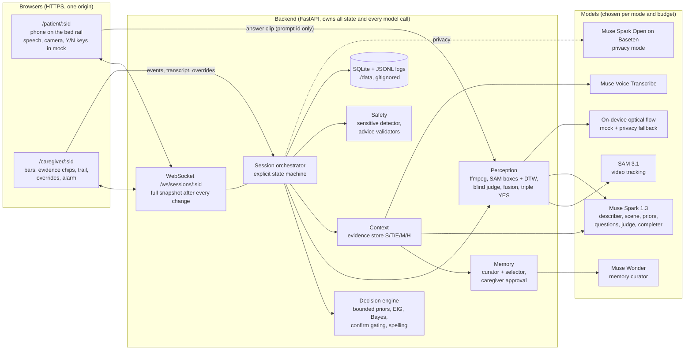
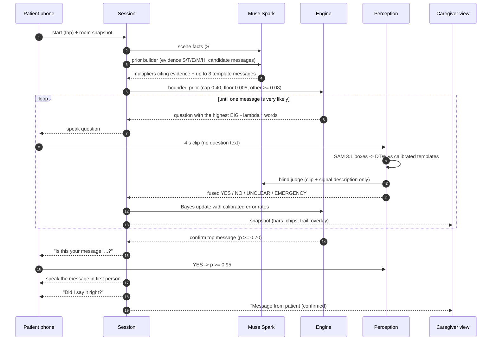

# Architecture

## One message, step by step

## Modules

| Path | What it does |
|---|---|
| `backend/app/engine/` | taxonomy v1 (EN/ID), priors with bounds (`priors.py`), closed-form EIG (`eig.py`), Bayes update (`posterior.py`), question pool and LLM-question validation (`questions.py`), the per-message policy (`policy.py`), spelling (`spelling.py`), personal base rates (`personal.py`), pain refinement (`refine.py`), template validation (`instantiation.py`) |
| `backend/app/sessions/` | state machine (`state_machine.py`), session orchestrator (`session.py`), session manager and WebSocket fan-out (`manager.py`), simulated patient (`simulated.py`), JSONL logs (`log.py`) |
| `backend/app/perception/` | ffmpeg normalisation (`media.py`), SAM box features (`features.py`), DTW (`dtw.py`), fusion (`fusion.py`), calibration wizard backend (`calibration.py`), answer pipeline (`pipeline.py`) |
| `backend/app/providers/` | interfaces (`base.py`), Meta Model API (`meta_api.py`), Baseten (`baseten.py`), Modal SAM (`modal_sam.py`), on-device tracker (`local.py`), mock (`mock.py`), selection by mode and budget (`registry.py`), structured calls with repair and fallback (`llm.py`), cost (`cost.py`) |
| `backend/app/roles.py` + `backend/app/prompts/*.md` | every model role: prompt (versioned), inputs, schema, fallback |
| `backend/app/context/`, `backend/app/memory/` | evidence store; Wonder curator, provenance validation, learning curve |
| `backend/app/safety/` | sensitive-topic detector (EN/ID keywords + LLM layer), advice and wording validators |
| `backend/app/relay/` | family relay agent (offer, approval, send, receipts, reply triage, follow-up) and its channels: WhatsApp Cloud API, or a simulated relative |
| `frontend/` | Vite + React + TypeScript views |
| `sim/` | engine simulation (`make sim`) |
| `scripts/` | API probes, live check, detector evaluation, letter statistics, synthetic media |

## Modes and where each role runs

| Role | Mock | Live | Privacy (partner) | Privacy (on-premises) |
|---|---|---|---|---|
| Spark text roles (priors, questions, completions, sentences, sensitive classifier) | rule-based mock | Muse Spark 1.3 | Muse Spark Open (Baseten or Modal) | Muse Glimmer on the hospital's server |
| Spark media roles (describer, framing, scene, blind judge) | mock | Muse Spark 1.3 | Muse Spark Open | stays on-device (mock describer; judge off) |
| Tracker | on-device optical flow | SAM 3.1 | self-hosted SAM 3.1 if configured, else on-device | same |
| Room transcript | typed lines | Muse Voice Transcribe | Muse Spark Open audio input | off (typed lines) |
| Memory curator | rule-based mock | Muse Wonder | Muse Spark Open | Muse Glimmer |

The budget guard can drop any live or privacy session to mock mid-way (90% of the budget).

## In-browser demo

`backend/app/browser.py` wraps the same `Session` for Pyodide (Python compiled to WebAssembly). The
hosted demo loads it in a Web Worker with numpy, pydantic, pyyaml and sqlite3 from the Pyodide CDN,
unpacks the backend sources (`scripts/build_pyodide_bundle.py`) and swaps the WebSocket for
`postMessage`. Same engine, same safety checks, mock providers, no server, no camera, no keys.

## Design decisions

- **The LLM supplies intuition; code decides.** Every model output is a proposal: multipliers are
  snapped to a fixed set, must cite evidence and are clipped; new messages come only from templates;
  questions are validated; the choice of question and the decision to speak are plain math.
- **Blind perception.** The judge never sees the question, so it cannot answer for the patient.
- **Same code in every mode.** Mock, live and privacy share the session, engine and roles; only the
  provider behind each role changes. The budget guard can switch a live session to mock mid-way.
- **One snapshot, two screens.** The backend pushes the whole session view; the patient screen
  simply never renders the probabilities.
