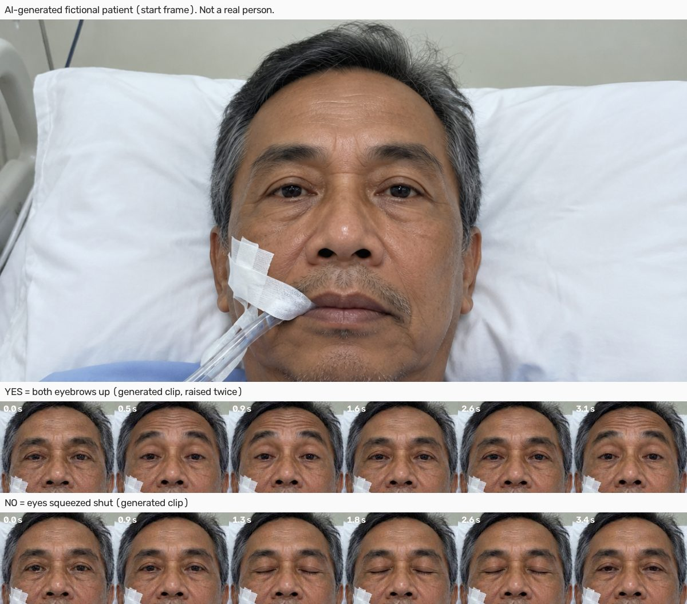

# Generated test clips: a photoreal, fictional patient

The cartoon clips in [`DETECTOR_EVAL_SYNTHETIC.md`](DETECTOR_EVAL_SYNTHETIC.md) passed easily, which
says little about real faces. Filming patients is out of the question, so we generated a fictional
ICU patient and animated the answer signals. Nobody in these clips exists.

## How the clips were made

- **Start frame:** GPT Image 2.5 through Higgsfield. Prompt, in short: a fictional Indonesian man in
  his early 60s, awake in an ICU bed, endotracheal tube taped at the mouth, seen by a phone on the
  bed rail.
- **Clips:** Seedance 2.0 (fast, 480p, 4 s, no audio) animating that same frame, one prompt per
  clip; output 752x560 at 24 fps. Every prompt starts "locked-off static camera" and describes one
  movement.
- **Signals:** YES is both eyebrows raised, once or twice. NO is both eyes squeezed shut for about
  one to two seconds. "No answer" clips are still, with distractors: natural blinks, a gaze shift to
  the side, a swallow. The emergency signal is the eyebrows raised three or more times.
- **Set:** calibration 8 clips (a 12-second rest, 3 YES, 3 NO, 1 emergency); evaluation 13 clips
  (3 YES, 4 NO, 4 no answer, 2 emergency). The YES clips include a late raise and a small, tired one.
- **Labels checked, not assumed:** for every clip we measured motion over time in a brow region
  and an eye region and looked at frame strips. One clip was excluded: its prompt asked for two
  raises and the model produced three, which is the emergency signal, so its label was ambiguous.
- **Cost:** about 85 Higgsfield credits. The clips stay in `data/labeled_generated/` (gitignored),
  with a manifest of each clip's label and variation.

Run it: `PYTHONPATH=backend:. backend/.venv/bin/python scripts/eval_detector.py --mode live
--data data/labeled_generated --name GENERATED --verbose`.

## What the realistic face exposed

Live models, the same 13 evaluation windows at every step. "Wrong" means a confident wrong answer;
"unclear" means the question is asked again.

| Step | Judge correct | Fused correct | Wrong | Unclear |
|---|---:|---:|---:|---:|
| Start: judge sees the whole 320x240 frame | 4 of 11 | 5 | 1 | 7 |
| Judge sees a crop around the signal body parts | 9 of 12 | 6 | 0 | 7 |
| Judge prompt v4 (a blink is not a held squeeze); SAM "seen" feature | 10 of 11 | 7 | 0 | 6 |
| Fusion as a logarithmic opinion pool | 12 of 12 | 11 | 0 | 2 |

The judge sometimes times out, so its count varies. Its answers also vary between runs: an
identical run at the first step scored 8 of 13 fused, 3 of them wrong. A judge-only check with two
runs per clip gave 12 of 26 on the whole frame, 24 of 26 on the crop, and 26 of 26 on the crop with
prompt v4.

1. **Resolution.** On a whole 320x240 frame this face is about 110 px wide and an eyebrow raise
   moves a few pixels. The judge reported "eyes open resting, no eyebrow raise" on clear raises.
   Calibration now takes the area SAM 3.1 tracked on the calibration clips, widens it, and the
   judge always watches that crop, cut from the phone's full-resolution clip
   (`calibration.signal_roi`).
2. **Blinks.** The judge read natural blinks as the NO squeeze. Prompt v4 spells out the
   difference: a blink lasts one or two frames, a squeeze stays shut for a second or more with
   tight wrinkles at the eye corners.
3. **Vanishing eyes.** With eyes squeezed shut, SAM sometimes no longer finds "eyes", and the
   pipeline treated the lost box as noise. Whether the part was seen at all is now a feature of its
   own. It did not fix SAM on these clips: here SAM mostly still found the closed eyes, and its
   box barely changed.
4. **Fusion.** A weighted average let two agreeing but modest readings (SAM "no answer" at 0.84,
   judge at 0.45) fall below the 0.65 threshold together. Independent sources now multiply, each
   raised to its calibration weight: agreement reinforces, and a YES-against-NO split stays UNCLEAR.

The cartoon set still scores 12 of 12 after these changes.

## Limits

One fictional identity, one start frame for calibration and evaluation (same pose and lighting),
generated motion that is cleaner than a weak or sedated patient's, and 13 evaluation windows. SAM's
box geometry is the weak part on this face (6 of 10 where it tracked); the judge carries the
decision. These numbers say nothing about real patients.
