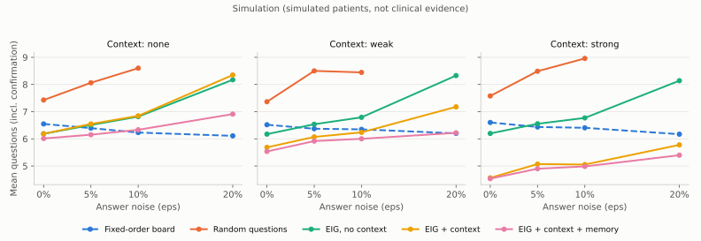
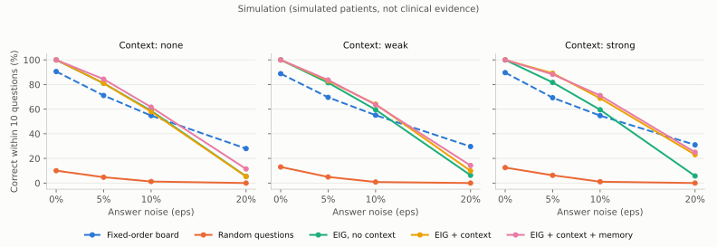
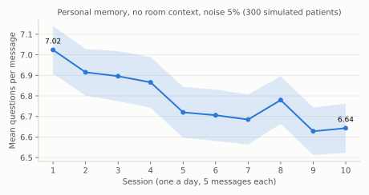

# Evaluation

> **Simulation, not clinical evidence.** Simulated patients answer yes/no questions with a
> fixed error rate. These numbers compare question-selection strategies under identical
> conditions; they say nothing about real patients. Detector accuracy on real clips is
> reported separately (section 2) once labeled clips are recorded.

## 1. Engine simulation

Generated by `make sim` (`python -m eval.sim.simulate --trials 2000 --seed 7`) in 93 s.
2,000 seeded trials per cell; within a cell every strategy faces the same patients and the
same true messages (paired comparison). Raw numbers: [`docs/sim_results.json`](sim_results.json).

**Setup.** 30 messages (taxonomy v1 plus three family members from the profile). Each simulated
patient has personal habits (base rates skewed by a log-normal factor, sigma 0.9) and 15 earlier
confirmed messages. The true message is drawn from those habits. Answers flip with probability eps.
Context: *weak* gives the true message a x2 evidence-backed multiplier half the time plus three x2
distractors; *strong* gives it x4 80% of the time plus two distractors (x2, sometimes x4).
All engine strategies use the same policy (confirm at 0.70, finalize at 0.95, cap of 10 questions
including confirmations and the spelling offer, plus one final confirmation when the tenth answer
leaves a message at 0.70 or more). The board asks categories in a fixed order, then items one by
one, then a confirmation; a cap of 10.

Columns: mean/median questions over finalized trials (including the confirmation); success = the
correct message finalized within the cap; wrong = a wrong message finalized (before the post-speak
"Did I say it right?" check, which gives the patient one more chance to retract it); spelling =
fell back to spelling; handover = cap reached or paused for the caregiver.

### Context none, eps = 0.00

| Strategy | Mean Q | Median Q | Success | Wrong | Spelling | Handover |
|---|---:|---:|---:|---:|---:|---:|
| Fixed-order board | 6.55 | 7 | 90.5% | 0.0% | 0.0% | 9.4% |
| Random questions | 7.43 | 8 | 10.1% | 0.0% | 0.0% | 90.0% |
| EIG, no context | 6.19 | 6 | 100.0% | 0.0% | 0.0% | 0.0% |
| EIG + context | 6.19 | 6 | 100.0% | 0.0% | 0.0% | 0.0% |
| EIG + context + memory | 6.01 | 6 | 100.0% | 0.0% | 0.0% | 0.0% |

### Context none, eps = 0.05

| Strategy | Mean Q | Median Q | Success | Wrong | Spelling | Handover |
|---|---:|---:|---:|---:|---:|---:|
| Fixed-order board | 6.39 | 6 | 71.1% | 0.9% | 3.3% | 24.6% |
| Random questions | 8.06 | 9 | 4.8% | 0.0% | 4.3% | 90.9% |
| EIG, no context | 6.51 | 6 | 81.0% | 0.4% | 0.8% | 17.8% |
| EIG + context | 6.55 | 6 | 81.0% | 0.4% | 0.9% | 17.7% |
| EIG + context + memory | 6.15 | 6 | 84.4% | 0.5% | 0.7% | 14.4% |

### Context none, eps = 0.10

| Strategy | Mean Q | Median Q | Success | Wrong | Spelling | Handover |
|---|---:|---:|---:|---:|---:|---:|
| Fixed-order board | 6.23 | 6 | 54.8% | 2.1% | 5.8% | 37.4% |
| Random questions | 8.60 | 9 | 1.2% | 0.0% | 9.2% | 89.5% |
| EIG, no context | 6.82 | 6 | 58.7% | 1.4% | 4.4% | 35.5% |
| EIG + context | 6.84 | 6 | 58.0% | 1.2% | 4.2% | 36.5% |
| EIG + context + memory | 6.33 | 6 | 61.7% | 1.6% | 3.8% | 33.0% |

### Context none, eps = 0.20

| Strategy | Mean Q | Median Q | Success | Wrong | Spelling | Handover |
|---|---:|---:|---:|---:|---:|---:|
| Fixed-order board | 6.11 | 6 | 28.0% | 10.8% | 5.9% | 55.3% |
| Random questions | n/a | n/a | 0.0% | 0.0% | 20.5% | 79.5% |
| EIG, no context | 8.17 | 7 | 5.5% | 0.1% | 14.3% | 80.2% |
| EIG + context | 8.35 | 7 | 5.3% | 0.1% | 15.4% | 79.1% |
| EIG + context + memory | 6.91 | 7 | 11.5% | 0.3% | 14.5% | 73.8% |

### Context weak, eps = 0.00

| Strategy | Mean Q | Median Q | Success | Wrong | Spelling | Handover |
|---|---:|---:|---:|---:|---:|---:|
| Fixed-order board | 6.52 | 7 | 88.8% | 0.0% | 0.0% | 11.2% |
| Random questions | 7.36 | 8 | 13.1% | 0.0% | 0.0% | 87.0% |
| EIG, no context | 6.17 | 6 | 100.0% | 0.0% | 0.0% | 0.0% |
| EIG + context | 5.69 | 5 | 100.0% | 0.0% | 0.0% | 0.0% |
| EIG + context + memory | 5.54 | 5 | 100.0% | 0.0% | 0.0% | 0.0% |

### Context weak, eps = 0.05

| Strategy | Mean Q | Median Q | Success | Wrong | Spelling | Handover |
|---|---:|---:|---:|---:|---:|---:|
| Fixed-order board | 6.37 | 6 | 69.6% | 0.1% | 4.0% | 26.2% |
| Random questions | 8.50 | 9 | 5.0% | 0.1% | 4.2% | 90.8% |
| EIG, no context | 6.54 | 6 | 81.5% | 0.4% | 0.8% | 17.3% |
| EIG + context | 6.07 | 6 | 83.0% | 0.5% | 1.4% | 15.2% |
| EIG + context + memory | 5.92 | 6 | 83.7% | 0.5% | 0.9% | 14.9% |

### Context weak, eps = 0.10

| Strategy | Mean Q | Median Q | Success | Wrong | Spelling | Handover |
|---|---:|---:|---:|---:|---:|---:|
| Fixed-order board | 6.35 | 6 | 55.1% | 2.4% | 5.8% | 36.8% |
| Random questions | 8.44 | 9 | 0.9% | 0.1% | 9.2% | 89.8% |
| EIG, no context | 6.79 | 6 | 59.6% | 0.9% | 3.9% | 35.7% |
| EIG + context | 6.24 | 6 | 64.0% | 1.6% | 3.1% | 31.2% |
| EIG + context + memory | 6.00 | 6 | 63.6% | 1.2% | 2.9% | 32.2% |

### Context weak, eps = 0.20

| Strategy | Mean Q | Median Q | Success | Wrong | Spelling | Handover |
|---|---:|---:|---:|---:|---:|---:|
| Fixed-order board | 6.20 | 6 | 29.6% | 11.1% | 4.6% | 54.7% |
| Random questions | n/a | n/a | 0.0% | 0.0% | 19.7% | 80.3% |
| EIG, no context | 8.33 | 7 | 6.3% | 0.1% | 13.2% | 80.4% |
| EIG + context | 7.18 | 7 | 9.9% | 0.2% | 14.1% | 75.8% |
| EIG + context + memory | 6.22 | 6 | 14.2% | 0.2% | 14.3% | 71.2% |

### Context strong, eps = 0.00

| Strategy | Mean Q | Median Q | Success | Wrong | Spelling | Handover |
|---|---:|---:|---:|---:|---:|---:|
| Fixed-order board | 6.60 | 7 | 89.6% | 0.0% | 0.0% | 10.3% |
| Random questions | 7.58 | 8 | 12.6% | 0.0% | 0.0% | 87.5% |
| EIG, no context | 6.20 | 6 | 100.0% | 0.0% | 0.0% | 0.0% |
| EIG + context | 4.56 | 4 | 100.0% | 0.0% | 0.0% | 0.0% |
| EIG + context + memory | 4.54 | 4 | 100.0% | 0.0% | 0.0% | 0.0% |

### Context strong, eps = 0.05

| Strategy | Mean Q | Median Q | Success | Wrong | Spelling | Handover |
|---|---:|---:|---:|---:|---:|---:|
| Fixed-order board | 6.44 | 6 | 69.3% | 0.6% | 3.5% | 26.7% |
| Random questions | 8.49 | 9 | 6.3% | 0.1% | 4.3% | 89.3% |
| EIG, no context | 6.55 | 6 | 81.7% | 0.2% | 0.9% | 17.2% |
| EIG + context | 5.07 | 5 | 89.1% | 0.3% | 0.8% | 9.8% |
| EIG + context + memory | 4.90 | 4 | 88.2% | 0.4% | 0.6% | 10.8% |

### Context strong, eps = 0.10

| Strategy | Mean Q | Median Q | Success | Wrong | Spelling | Handover |
|---|---:|---:|---:|---:|---:|---:|
| Fixed-order board | 6.41 | 6 | 54.8% | 2.6% | 4.9% | 37.8% |
| Random questions | 8.96 | 9 | 1.1% | 0.1% | 9.5% | 89.3% |
| EIG, no context | 6.77 | 6 | 59.5% | 1.4% | 4.6% | 34.5% |
| EIG + context | 5.05 | 4 | 68.8% | 0.8% | 2.5% | 27.9% |
| EIG + context + memory | 4.98 | 4 | 71.1% | 1.0% | 2.6% | 25.3% |

### Context strong, eps = 0.20

| Strategy | Mean Q | Median Q | Success | Wrong | Spelling | Handover |
|---|---:|---:|---:|---:|---:|---:|
| Fixed-order board | 6.17 | 6 | 31.0% | 10.9% | 4.3% | 53.8% |
| Random questions | n/a | n/a | 0.0% | 0.0% | 18.7% | 81.3% |
| EIG, no context | 8.14 | 7 | 5.8% | 0.0% | 14.1% | 80.1% |
| EIG + context | 5.78 | 5 | 23.1% | 0.1% | 11.2% | 65.6% |
| EIG + context + memory | 5.40 | 5 | 25.0% | 0.1% | 12.0% | 62.8% |

### Phase 1 definition of done

At eps = 0.10 with strong context, EIG + context needs **5.05** mean questions
vs **6.41** for the fixed-order board (PASS); success 68.8% vs 54.8%.

### Learning curve (personal memory)

`python -m eval.sim.learning_curve`: 300 simulated patients, 10 daily sessions of 5 messages, noise 5%, no room context. Confirmed messages feed the personal base rates (Dirichlet, 3-day half-life, factor clipped to [0.5, 3]). Mean questions per message fall from **7.02** in session 1 to **6.64** in session 10. The effect is modest by design: the personal factor is bounded, and caregiver-approved memory facts (which act as room context in the live system) are not simulated here.

## 2. Detector evaluation

See `eval/detector.py`. Real-patient numbers need labelled clips recorded by
consenting participants in `data/labeled/{yes,no,rest,emergency}/` (gitignored); none are
recorded yet. Results on generated clips of a fictional patient, in live and privacy mode,
are in [`DETECTOR_DATA_GENERATED.md`](DETECTOR_DATA_GENERATED.md), and on cartoon clips in
[`DETECTOR_EVAL_SYNTHETIC.md`](DETECTOR_EVAL_SYNTHETIC.md).
